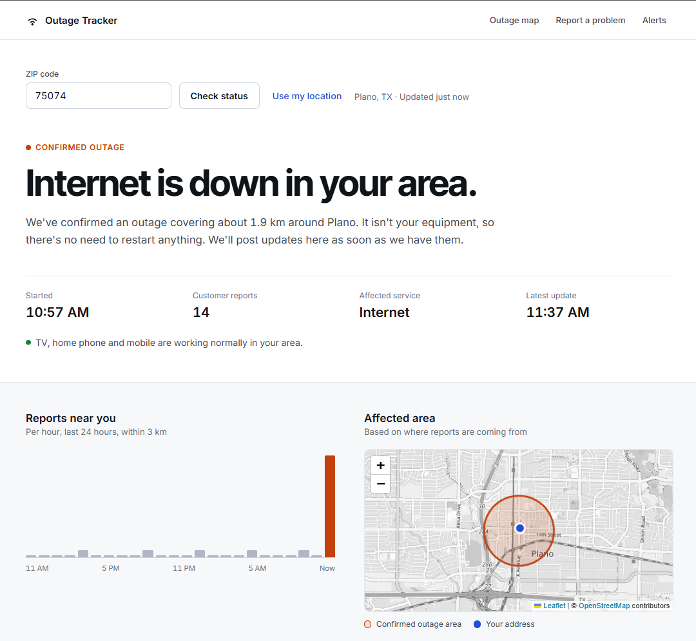
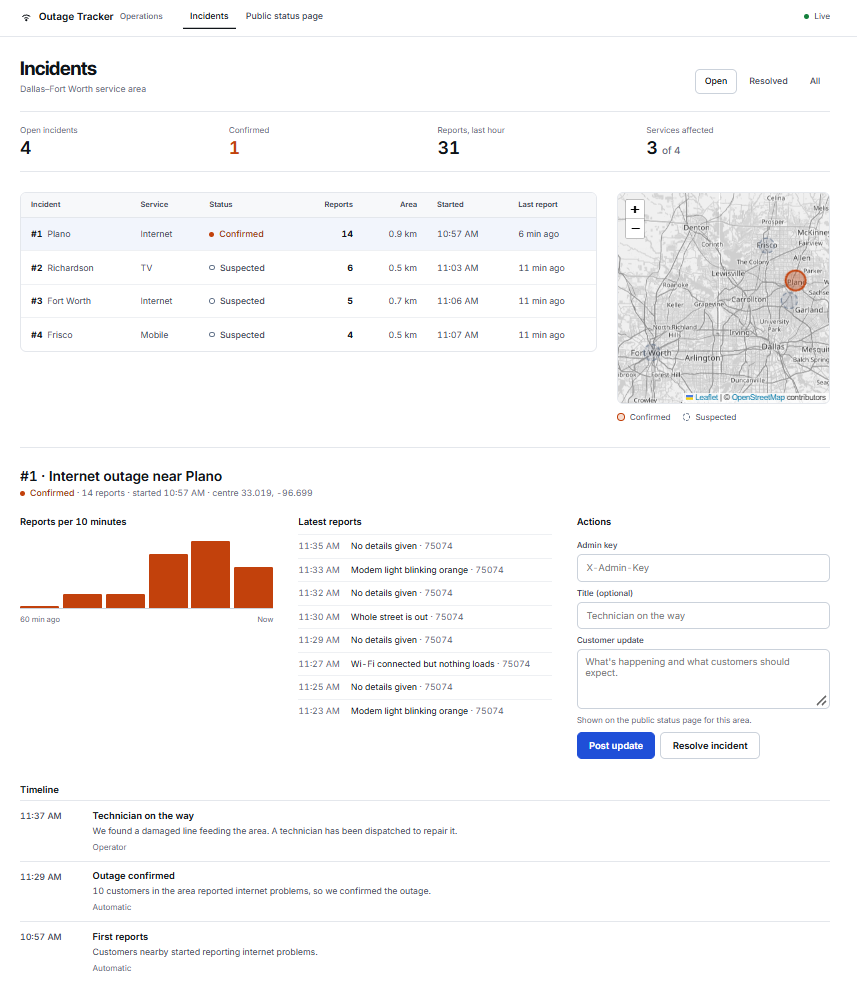
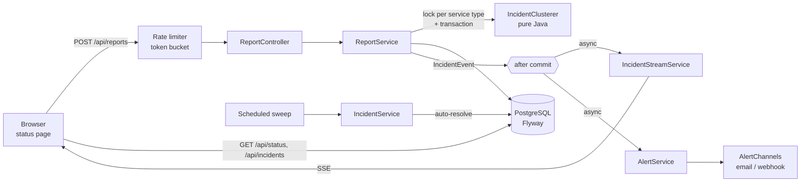

# Outage Tracker

A crowdsourced service-outage tracker for an ISP, built with **Java 21 + Spring Boot 3**.

Customers check "is it down where I am?" and report problems. The backend clusters nearby reports in real time into **incidents**, promotes them from *suspected* to *confirmed* as evidence builds, auto-resolves them when reports stop, pushes live updates to every open page over **Server-Sent Events**, and alerts subscribers whose area is affected.

It ships with two front ends, each built for a different audience:

- **Public status page (`/`)**: enter a ZIP and get a plain answer ("Internet is down in your area"), the incident timeline, a 24-hour chart of reports nearby, and the affected area on a map.
- **Operator dashboard (`/ops`)**: every incident in a table with live counts and a map, plus actions to post customer updates and resolve incidents.

  





## Features

- **Streaming geo/time clustering:** each report either joins the nearest open incident within 3 km, opens a new incident once 3+ recent reports are close together (density-based, in the spirit of DBSCAN), or waits unclustered.
- **Incident lifecycle:** `SUSPECTED → CONFIRMED` at 10 reports, `→ RESOLVED` after 45 quiet minutes (scheduled sweep) or by an operator.
- **Correct under concurrency:** a per-service-type lock is held *around* the transaction, so 40 simultaneous reports at one spot produce exactly one incident (there's a test for it). Optimistic locking (`@Version`) is a second line of defense.
- **Status by location:** `/api/locations/{zip}` answers for one place: per-service health, the incidents covering that point, the most severe incident's timeline, and reports per hour within 3 km over the last 24 hours.
- **Incident timelines:** automatic entries when an incident opens, is confirmed and is resolved, plus updates posted by operators. These are written in the same transaction as the incident change, so the timeline can't disagree with the incident.
- **Live pages:** both front ends update instantly over SSE, with polling as a fallback.
- **Alerts:** subscribers pick a point and radius. When an incident overlapping their area is confirmed or resolved, they're notified through pluggable `AlertChannel`s (email stub and HTTPS webhook included).
- **Abuse protection:** a hand-written, thread-safe **token bucket rate limiter** per IP (429 + `Retry-After`), plus duplicate suppression (one report per client per service every 15 min, keyed by a SHA-256 hash so raw IPs aren't stored).
- **Production basics:** Flyway migrations, RFC 9457 `problem+json` errors with per-field validation messages, Actuator health probes, Prometheus metrics (`outage.reports.submitted`, `outage.report.submit` p50/p95/p99, `outage.alerts.sent`…), virtual threads, Docker and CI.

## Architecture



**Design choices worth talking about:**

| Decision | Why |
|---|---|
| Clustering rules live in a framework-free class (`IncidentClusterer`) that takes snapshots and returns a sealed `Decision` | Business logic is unit-testable in milliseconds with no Spring or DB; the service layer only loads data and applies decisions. |
| Bounding-box SQL pre-filter, then an exact haversine check in Java | The box query uses ordinary B-tree indexes, so no PostGIS is needed; precision comes from the second step. A unit test walks the compass to prove the box always contains the circle (it caught a real bug: a rounded 111.32 km/degree made the box too small). |
| Lock acquired *before* the transaction starts, released *after* it commits | Locking inside `@Transactional` lets a second thread read before the first commits, which causes duplicate incidents. |
| Events delivered with `@TransactionalEventListener` + `@Async` | Subscribers never hear about rolled-back changes, and a slow webhook can't slow down report submission. |
| Running-mean centroid update (`O(1)` per report) | No need to reload every member report when an incident grows. |

## Running it

**Requirements:** JDK 21 and Maven 3.9+ (or just Docker).

```bash
# In-memory H2 with demo data around Dallas–Fort Worth
mvn spring-boot:run
# open http://localhost:8080
```

```bash
# Full stack: app + PostgreSQL
docker compose up --build
# open http://localhost:8080
```

The demo seed replays a realistic day through the real clustering pipeline, in time order: a trickle of background reports over the last 24 hours (which correctly does *not* cluster), then four outages building over the last 40 minutes. You get a confirmed internet outage in Plano (ZIP 75074, with a sample operator update), and suspected incidents in Richardson (75080), Frisco (75034) and Fort Worth (76102). A demo subscriber in Plano gets an alert in the logs when that outage is confirmed. Seeded incidents auto-resolve after 45 quiet minutes, exactly like real ones.

- Status page: http://localhost:8080 (try ZIPs 75074, 75080, 76011)
- Operator dashboard: http://localhost:8080/ops (admin key: `change-me`, or set `ADMIN_API_KEY`)

ZIP lookup uses a small built-in table of DFW ZIP codes (`src/main/resources/zips.csv`) so the demo works offline; production would call a geocoding service. "Use my location" works anywhere.

## API

| Method | Path | Description |
|---|---|---|
| `POST` | `/api/reports` | Submit a report → `201` with the report and the incident it joined (if any) |
| `GET` | `/api/reports/recent?limit=50` | Latest reports |
| `GET` | `/api/incidents?scope=ACTIVE\|RESOLVED\|ALL&serviceType=` | List incidents |
| `GET` | `/api/incidents/{id}` | Incident with recent reports, timeline, and reports per 10 min over the last hour |
| `GET` | `/api/incidents/stream` | Server-Sent Events feed of incident changes |
| `GET` | `/api/status` | Health per service: `OPERATIONAL` / `DEGRADED` / `OUTAGE` |
| `GET` | `/api/locations/{zip}` | Status at a ZIP: per-service health, covering incidents, timeline, 24h hourly reports |
| `GET` | `/api/locations?lat=&lng=` | Same, for coordinates |
| `GET` | `/api/zips` | ZIP codes the demo lookup knows |
| `POST` | `/api/subscriptions` | Subscribe to alerts for a point + radius |
| `DELETE` | `/api/subscriptions/{token}` | Unsubscribe |
| `POST` | `/api/admin/incidents/{id}/resolve` | Resolve manually (header `X-Admin-Key`) |
| `POST` | `/api/admin/incidents/{id}/updates` | Post a customer update to the timeline (header `X-Admin-Key`) |
| `GET` | `/actuator/health`, `/actuator/prometheus` | Health probes and metrics |

```bash
curl -X POST localhost:8080/api/reports -H 'Content-Type: application/json' \
  -d '{"serviceType":"INTERNET","latitude":32.95,"longitude":-96.73,"zipCode":"75080"}'
```

## Tests

```bash
mvn verify
```

- **Unit (pure Java):** clustering decisions, haversine/bounding-box/centroid math, time bucketing, token bucket (including a 16-thread contention test).
- **Unit (Mockito):** alert fan-out, distance/footprint overlap, failure isolation between channels.
- **Integration (`@SpringBootTest`, H2 + Flyway):** incident open/confirm/auto-resolve and timelines with a controllable clock, the 40-thread concurrency test, and the HTTP API through MockMvc (location status, operator updates, validation errors, 409 duplicate, 429 rate limit, 401 admin).

## Load testing

`loadtest/report-load.js` is a [k6](https://k6.io) script that drives 500 req/s of reports across 20 hotspots; instructions are at the top of the file.

## Scaling further

- **Multiple instances:** replace the in-JVM lock with a PostgreSQL advisory lock (`pg_advisory_xact_lock(hash(service_type))`), and the in-memory rate limiter with Redis.
- **Higher write volume:** put reports onto Kafka partitioned by service type + geohash, so each partition is clustered by a single consumer.
- **Geo queries at scale:** PostGIS `geography` columns with a GiST index and `ST_DWithin`.
- **Auth:** Spring Security with OAuth2/OIDC for the operator endpoints.
